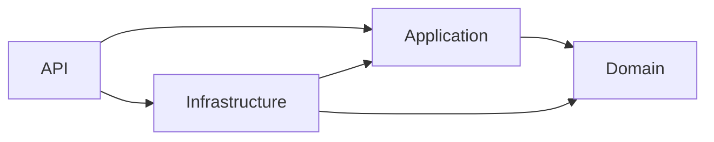

# ProductCatalog

Backend de catálogo de produtos em C# / .NET 10 LTS, ASP.NET Core, EF Core e PostgreSQL. Implementa cadastro, consulta individual, pesquisa paginada, atualização e exclusão lógica. O domínio protege suas invariantes; os casos de uso são independentes de HTTP e da persistência concreta.

## Estrutura e dependências

```text
src/
  ProductCatalog.Domain/          # Product, ProductPrice, invariantes e exceções
  ProductCatalog.Application/     # Comandos, consultas, handlers, validação e interfaces
  ProductCatalog.Infrastructure/  # EF Core, PostgreSQL, repositório, migrations e readiness
  ProductCatalog.Api/             # Controllers, JWT, autorização, OpenAPI e ProblemDetails
tests/
  ProductCatalog.Domain.Tests/
  ProductCatalog.Application.Tests/
  ProductCatalog.Infrastructure.IntegrationTests/
  ProductCatalog.Api.IntegrationTests/
  Shared/                        # Fixture PostgreSQL compartilhada por compilação
```



A referência da API à infraestrutura serve à composição de dependências em `Program.cs`. Controllers conhecem apenas os handlers da aplicação. O domínio não tem pacotes externos. Não há mediator, mapeador automático, repositório genérico, eventos ou specifications sem necessidade concreta.

As premissas, decisões e riscos estão em [docs/architecture.md](docs/architecture.md). O plano e o resultado da validação estão em [docs/validation.md](docs/validation.md).

## Pré-requisitos

- Para desenvolvimento: SDK .NET **10.0.403**, ou patch posterior da mesma faixa, e PowerShell 7 para os scripts.
- Para o ambiente local completo: Docker Engine / Docker Desktop com containers Linux e Docker Compose v2.
- Para testes PostgreSQL: Docker com `RUN_POSTGRES_TESTS=1`, ou um PostgreSQL 17 de testes com `TEST_POSTGRES_CONNECTION`.

Nesta máquina o SDK foi disponibilizado em `F:\DotNet-projetos\.tools\dotnet`. O wrapper `scripts/dotnet.ps1` usa esse SDK quando presente; em outra máquina usa o `dotnet` instalado. Não é necessário alterar o PATH global.

## Executar com Docker Compose

Na raiz desta solução:

```powershell
./scripts/Initialize-Local.ps1
docker compose up --build -d
docker compose ps -a
```

O script gera três segredos aleatórios em `.env`, que é ignorado pelo Git. Ele preserva um `.env` existente. O Compose sobe PostgreSQL, Keycloak de desenvolvimento, uma execução de migrations que termina com código 0 e a API. A API espera a conclusão das migrations e a saúde do provedor de identidade.

- Swagger UI: <http://localhost:5080/swagger>
- OpenAPI: <http://localhost:5080/swagger/v1/swagger.json>
- Liveness: <http://localhost:5080/health/live>
- Readiness PostgreSQL: <http://localhost:5080/health/ready>
- Keycloak: <http://localhost:8080>, administrador `local-admin`, senha no `.env`.

As portas publicadas ficam vinculadas a `127.0.0.1`. O Compose utiliza `Development` e HTTP local. O Keycloak usa armazenamento efêmero para a demonstração; os dados de produtos ficam em um volume PostgreSQL. Não use esta configuração de identidade em produção.

Para parar preservando produtos: `docker compose down`. Alterações no schema devem executar novamente `docker compose run --rm migrate` antes de iniciar a nova API. As credenciais do banco no `.env` precisam continuar correspondendo às do volume já inicializado.

## Usar a API autenticada

O Keycloak importa um realm com um cliente de serviço e os scopes `catalog.read` e `catalog.write`. O token expira em cinco minutos. O script usa o fluxo OAuth2 `client_credentials` e o segredo do `.env`:

```powershell
$token = ./scripts/Get-DevToken.ps1
$headers = @{ Authorization = "Bearer $token" }

$created = Invoke-WebRequest -Method Post -Uri 'http://localhost:5080/api/products' `
  -Headers $headers -ContentType 'application/json' `
  -Body '{"name":"Teclado USB","description":"ABNT2","price":129.90,"isActive":true}'
$product = $created.Content | ConvertFrom-Json

$read = Invoke-WebRequest -Uri "http://localhost:5080/api/products/$($product.id)" -Headers $headers
$headers['If-Match'] = [string]$read.Headers.ETag[0]

$updated = Invoke-WebRequest -Method Put -Uri "http://localhost:5080/api/products/$($product.id)" `
  -Headers $headers -ContentType 'application/json' `
  -Body '{"name":"Teclado USB","description":"ABNT2","price":99.90,"isActive":false}'

Invoke-RestMethod -Uri 'http://localhost:5080/api/products?page=1&pageSize=20&search=teclado&isActive=false' -Headers $headers

$headers['If-Match'] = [string]$updated.Headers.ETag[0]
Invoke-WebRequest -Method Delete -Uri "http://localhost:5080/api/products/$($product.id)" -Headers $headers
```

No Swagger, use **Authorize** e cole apenas o token. `PUT` e `DELETE` exibem o parâmetro de header `If-Match`: use o `ETag` recebido, incluindo as aspas.

| Método | Rota | Permissão | Resposta principal |
| --- | --- | --- | --- |
| POST | `/api/products` | `catalog.write` | 201, Location, ETag e produto |
| GET | `/api/products/{id}` | `catalog.read` | 200 e ETag; 404 se ausente ou excluído |
| GET | `/api/products` | `catalog.read` | 200 com items, totalCount, page, pageSize |
| PUT | `/api/products/{id}` | `catalog.write` | 200 e novo ETag |
| DELETE | `/api/products/{id}` | `catalog.write` | 204, preservando a linha no banco |

As requisições de cadastro exigem `name` e `price`; `isActive` assume `true`. A atualização exige `name`, `price` e `isActive`; `description` ausente ou vazia remove a descrição. O `PUT` substitui esses dados; não é um PATCH.

Filtros da listagem: `page` entre 1 e 1.000.000; `pageSize` entre 1 e 100, padrão 20; `search` até 200 caracteres; `isActive` opcional. Pesquisa literal por parte do nome, sem diferenciar maiúsculas, com escape de `%`, `_` e `\`. Ordem: criação decrescente e UUID como desempate.

Erros usam `application/problem+json` e `traceId`: 400 para entrada inválida; 401 para token ausente/inválido; 403 para falta de scope; 404 para produto ausente/excluído; 412 para versão desatualizada; 428 para `If-Match` ausente; 429 ao exceder 120 requisições/minuto por sujeito/IP e instância; 500 sem detalhes internos. JSON inválido também retorna 400. Headers ETag fracos, múltiplos ou `*` não são aceitos.

## Executar a API pelo SDK

Para desenvolver com banco e identidade do Compose:

```powershell
./scripts/Initialize-Local.ps1
docker compose up -d postgres identity

$passwordLine = Get-Content .env | Where-Object { $_.StartsWith('POSTGRES_PASSWORD=') }
$password = $passwordLine.Substring('POSTGRES_PASSWORD='.Length)
$env:ConnectionStrings__Catalog = "Host=localhost;Port=5432;Database=product_catalog;Username=product_catalog;Password=$password"

./scripts/dotnet.ps1 restore ProductCatalog.slnx --locked-mode
./scripts/dotnet.ps1 tool restore
./scripts/dotnet.ps1 ef database update --project src/ProductCatalog.Infrastructure
./scripts/dotnet.ps1 run --project src/ProductCatalog.Api
```

O perfil local usa `http://localhost:5080` e o realm no host. Também é possível apontar as variáveis para PostgreSQL e um provedor OIDC externos. Fora de `Development`, `Authentication__Authority` deve ser HTTPS e `Authentication__Audience` deve identificar esta API. Opcionalmente, `Authentication__MetadataAddress` define a URL de descoberta interna; o provedor continua precisando emitir o issuer e a audience corretos.

## Compilar e testar

```powershell
# Domínio, aplicação, HTTP/JWT e consistência do modelo/migration; PostgreSQL fica explicitamente skipped.
./scripts/Verify.ps1

# Suíte completa usando Testcontainers e Docker.
./scripts/Verify.ps1 -Postgres

# Alternativa: servidor real de testes, sem Docker. Usuário com permissão CREATEDB.
$env:TEST_POSTGRES_CONNECTION = 'Host=localhost;Port=5432;Database=postgres;Username=tests;Password=...'
./scripts/Verify.ps1
```

O runner é **Microsoft Testing Platform**, configurado em `global.json`, com xUnit v3, NSubstitute e asserções nativas. Relatórios TRX são gravados em `artifacts/test-results`. Não se usa EF InMemory ou SQLite para simular PostgreSQL. A fixture cria um banco com UUID e remove somente esse banco ao terminar. Uma configuração de integração habilitada que falhe gera falha de teste; não vira um skip silencioso.

## Evoluir o schema

```powershell
./scripts/dotnet.ps1 tool restore
./scripts/dotnet.ps1 ef migrations add NomeDaAlteracao --project src/ProductCatalog.Infrastructure --output-dir Persistence/Migrations
./scripts/dotnet.ps1 ef migrations script --idempotent --project src/ProductCatalog.Infrastructure --output artifacts/migrations.sql
```

Revise e aplique migrations como etapa de implantação, com credenciais de DDL separadas das credenciais da API. Outra opção disponível na imagem publicada é `dotnet ProductCatalog.Api.dll --migrate`. Inicializações normais da API não executam migrations. O exemplo Compose utiliza um único usuário por simplicidade local.

## Produção

Configure um provedor OIDC mantido, issuer HTTPS, audience e scopes; PostgreSQL com TLS validado, backups e usuário de menor privilégio; hosts permitidos e certificados HTTPS do Kestrel. O Swagger é exposto somente em `Development`. A imagem da API executa como usuário sem privilégios. Segredos devem vir do ambiente ou secret manager.

Se TLS for terminado por proxy, configure explicitamente os proxies confiáveis e os forwarded headers antes da aplicação; esta base não confia automaticamente em headers fornecidos por clientes. O rate limiter é local ao processo: a limitação global de múltiplas réplicas pertence ao gateway. Não há CORS aberto, autenticação própria por senha nem dados sensíveis no corpo de erros.

Versões NuGet são centralizadas, fixadas e acompanhadas de lock files; atualizações devem incluir restore, auditoria e a suíte completa. Não foi criado workflow GitHub Actions porque a pasta não tem repositório/remoto GitHub e isso não foi solicitado separadamente.
